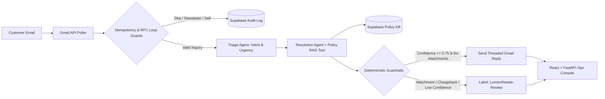

# Lumen Audio — Autonomous AI Customer Support Engine

[](https://onrender.com)
[](https://python.org)
[](https://tiangolo.com)
[](https://pydantic.dev)
[](https://react.dev)
[](https://supabase.com)

An end-to-end, production-hardened customer support automation engine built for **Lumen Audio**. It monitors a live support inbox via **Gmail OAuth 2.0**, enforces RFC anti-loop and idempotency guards, classifies and resolves inquiries using a **two-stage Pydantic AI RAG pipeline** with automatic multi-model failover, and routes high-risk edge cases to a **React + TypeScript** human-review console.

---

## System Architecture



---

## Key Engineering Highlights

* **Zero-Loop Email Ingestion (`app/gmail.py`, `app/guards.py`)**: Deduplicates messages via unique `gmail_message_id` constraints in Supabase and blocks auto-responder loops using RFC headers (`Auto-Submitted`, `List-Unsubscribe`, `Precedence: bulk/list`) and Gmail state labels (`Lumen/Processed`, `Lumen/Needs-Review`).
* **Two-Tier Agentic Routing + Failover (`app/ai/classifier.py`, `app/ai/agent.py`)**: Separates fast intent/urgency classification from tool-augmented policy retrieval (`lookup_company_policies`), with automatic retry backoff and multi-model failover across Gemini models to handle transient `503` spikes.
* **"Model Proposes, Code Decides" Guardrails (`app/ai/decide.py`)**: Deterministic Python rules override LLM outputs whenever emails contain photo attachments, chargeback/legal threats, high-urgency warranty claims, or confidence scores below `0.75`.
* **Golden Dataset Regression Evals (`evals/test_evals.py`)**: Uses `pydantic-evals` to benchmark classification and escalation accuracy across edge cases before deployment.
* **Multi-Stage Docker Build & Ops Console (`Dockerfile`, `dashboard/`, `app/main.py`)**: Compiles the React/TypeScript frontend and FastAPI + background worker runtime into a single lightweight container protected by HTTP Basic Auth.

---

## Repository Structure

```text
lumen-support-engine/
├── app/
│   ├── ai/
│   │   ├── agent.py         # Tool-calling resolution agent + multi-model failover
│   │   ├── classifier.py    # Fast intent & urgency triage router
│   │   ├── decide.py        # Deterministic escalation guardrails
│   │   └── schemas.py       # Typed Pydantic structured outputs
│   ├── config.py            # Environment configuration
│   ├── db.py                # Supabase persistence & policy search
│   ├── gmail.py             # OAuth 2.0 Gmail client & thread responder
│   ├── guards.py            # RFC header & self-loop filters
│   ├── main.py              # FastAPI REST API + static React host
│   ├── pipeline.py          # End-to-end orchestration workflow
│   └── poller.py            # Asynchronous background worker
├── dashboard/               # React + TypeScript Admin Operations Console
├── evals/
│   └── test_evals.py        # pydantic-evals regression benchmark suite
├── policies/                # Markdown product, setup & warranty knowledge base
├── scripts/
│   ├── auth_gmail.py        # One-time OAuth 2.0 refresh token generator
│   └── seed_policies.py     # Knowledge base seeder for Supabase
├── supabase/migrations/     # SQL schema & role permissions
├── Dockerfile               # Multi-stage Node + Python uv production build
├── docker-compose.yml       # Local/VPS container orchestration
└── start.sh                 # Unbuffered dual-process entrypoint
```

---

## Local Quickstart

```bash
# 1. Clone and configure environment
git clone https://github.com
cd lumen-support-engine
cp .env.example .env

# 2. Install Python dependencies & seed Supabase policies
uv sync
uv run python -m scripts.seed_policies

# 3. Build React Admin Dashboard
cd dashboard && npm install && npm run build && cd ..

# 4. Run Admin Console & Gmail AI Poller
uv run fastapi run app/main.py --port 8000
uv run python -m app.poller
```
